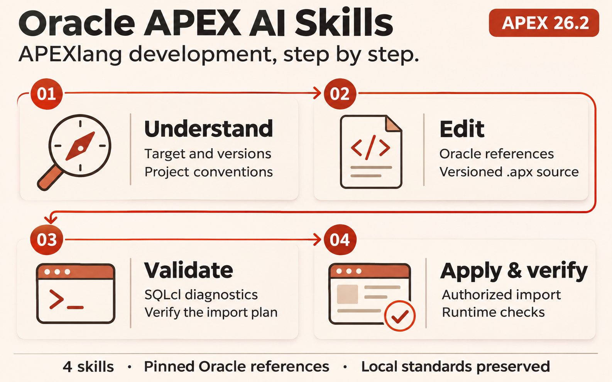

# Oracle APEX AI Skills APEXlang

**Develop Oracle APEX with AI, versioned source and your project's standards.**

Four coordinated skills for **Codex and Claude Code** that guide an agent from understanding an application to editing APEXlang, validating it with Oracle SQLcl and verifying an authorized change in the running application.

[Português do Brasil](README.pt-BR.md) · [Get started](#get-started-in-3-steps) · [Capabilities](#what-you-can-do) · [Examples](#example-requests) · [Documentation](#documentation)

[](https://github.com/andre-simplifica/oracle-apex-ai-skills-apexlang/actions/workflows/validate.yml) [MIT core](LICENSE) · [Oracle references: UPL 1.0](THIRD_PARTY_NOTICES.md)



APEXlang expresses an APEX application as editable text files. This kit gives your coding agent the references, project context and tools to work with those files. It installs as a **managed skill kit in your repository**; see the [Codex](docs/install-codex.md) and [Claude Code](docs/install-claude-code.md) setup guides.

**Current reviewed release: APEX 26.2.** Connected work requires SQLcl 26.3+ and ORDS 26.3+. New APEX feature releases are enabled after a specific compatibility review.

## What you can do

| Your task | What the kit provides |
| --- | --- |
| Adopt an application after an APEX upgrade | A readiness review, a complete APEXlang baseline and SQL recovery guidance. |
| Add or change pages and components | Version-matched Oracle references, examples and instructions for focused source changes. |
| Fix invalid APEXlang | Compiler diagnostics with source location, property and valid values when available. |
| Find the right implementation pattern | Ranked search in English or Portuguese, bounded reads and five curated Oracle 26.2 examples. |
| Prepare an import | Source and drift checks, explicit scope, compiler evidence and a plan that expires after 30 minutes. |
| Keep your team's conventions | Managed updates that preserve project-owned profiles, patterns, policies and migrations. |

The workflow also covers PL/SQL, REST integrations, shared DEV object locks and release preparation. The [technical overview](docs/technical-overview.md) explains what each helper checks.

## Get started in 3 steps

### 1. Install in your project

Ask your agent:

```text
Install Oracle APEX AI Skills APEXlang in this project from
https://github.com/andre-simplifica/oracle-apex-ai-skills-apexlang.
Preserve the existing project standards and the previous kit. Pin the source
commit, review the installation plan, then install and run status/doctor.
Do not connect to Oracle as part of file installation.
```

The installer copies four skills, offline helpers and pinned Oracle references. [Installation details and CLI commands](docs/install-codex.md).

### 2. Check the installation

From your consuming project's root:

```bash
python3 Util/apexlang/manage_oracle_apexlang_skills.py status --project-root .
python3 Util/apexlang/manage_oracle_apexlang_skills.py doctor --project-root .
```

`HEALTHY` confirms managed file integrity. `FILES_READY` confirms the file setup; live environment checks and application readiness follow separately.

### 3. Start with the application context

```text
Use $oracle-apex-ai-skills-apexlang to inspect this project's APEXlang source
and application context. Summarize the version evidence, local conventions
and next validation step. Report any missing target information.
```

For Claude Code, follow its [discovery setup](docs/install-claude-code.md). For a recently upgraded application, start with [first application adoption](docs/first-application.md).

## How a change moves through the kit

1. **Understand.** Confirm the target, versions, source state and project conventions.
2. **Edit.** Consult the pinned Oracle inventory and change the relevant `.apx` source.
3. **Validate.** Compile the complete application offline, inspect diagnostics, compare a fresh export and verify the proposed import scope.
4. **Apply and verify.** For an authorized target and operation, import, test behavior and permissions, then re-export to reconcile the delivered state.

The helpers prepare and verify import plans; they do not execute those plans. Read the [daily workflow](skills/oracle-apexlang-dev/references/daily-workflow.md) for the full procedure.

## Example requests

**Adopt an existing application**

> Assess the application identified in this project's profile after its upgrade to APEX 26.2. Export and version its first complete APEXlang baseline with SQL recovery. Report readiness and proposed remediation separately.

**Improve a report**

> Add a status filter to the existing orders report in this project's APEXlang source. Reuse the actual columns and authorization rules. Validate the complete application and prepare the import plan for review.

**Diagnose a compiler error**

> Validate this APEXlang application, explain each compiler error using the matching Oracle definition and propose the smallest source correction.

**Explore the included patterns**

The catalog covers report + modal form, master-detail grids, charts, a calendar and filter + refresh behavior. Each entry includes dependencies, adaptation notes and compiler evidence.

```bash
python3 Util/apexlang/oracle_reference.py search --query 'mestre detalhe' --limit 3
python3 Util/apexlang/oracle_reference.py read --id example:26.2:master-detail-grid
```

See [reference search and examples](skills/oracle-apexlang-dev/references/oracle-reference-policy.md). Compiler evidence for an example does not establish business behavior in your application.

## Four skills, one entry point

Start with **`oracle-apex-ai-skills-apexlang`**. It routes to the relevant workflow:

| Skill | Responsibility |
| --- | --- |
| [`oracle-apex-ai-skills-apexlang`](skills/oracle-apex-ai-skills-apexlang/SKILL.md) | Install, update, check versions and choose the next workflow. |
| [`oracle-apexlang-dev`](skills/oracle-apexlang-dev/SKILL.md) | Develop APEXlang, review migrations, debug and validate changes. |
| [`oracle-apexlang-export`](skills/oracle-apexlang-export/SKILL.md) | Establish baselines and prepare exports, recovery and releases. |
| [`oracle-apexlang-object-lock`](skills/oracle-apexlang-object-lock/SKILL.md) | Coordinate changes to shared DEV database objects. |

## Compatibility

| Component | Requirement |
| --- | --- |
| APEX | Minimum and currently reviewed feature release: **26.2**. |
| SQLcl | **26.3+**. Tested builds and compiler evidence are recorded in [validation](docs/validation.md). |
| ORDS | **26.3+**; confirm the actual server version. |
| Database | Supported 19c RU 19.18+ or Oracle AI Database 26ai 23.26.0+. |
| Future APEX releases | Require a reviewed inventory, APIs and migration workflow. |

For APEX 24.2 and its SQL-based workflow, use the separate [Oracle APEX AI Skills](https://github.com/andre-simplifica/oracle-apex-ai-skills) kit. Both kits have distinct installation paths and can coexist.

## Evidence and change boundaries

- **File installation is offline.** It does not connect to Oracle, import applications or install the object-lock runtime.
- **Plans are checked against current evidence.** Source, deployment configuration, scope, SQLcl version and expiry must still match. Live target identity and authorization are verified before execution.
- **Application delivery follows project policy.** Selected-file imports are for eligible development/test changes. Production requires a complete tested artifact and explicit authorization.
- **Validation has separate stages.** File integrity, compiler success, import outcome and runtime checks are reported individually.

The Oracle reference tree is preserved unmodified, pinned by commit and verified with SHA-256. See [validation evidence](docs/validation.md), [deployment and recovery](skills/oracle-apexlang-export/references/deployment-and-recovery.md) and [security](SECURITY.md).

## Documentation

| I want to… | Start here |
| --- | --- |
| Install with my agent | [Codex](docs/install-codex.md) · [Claude Code](docs/install-claude-code.md) |
| Adopt my first application | [First application](docs/first-application.md) · [Readiness and baseline](skills/oracle-apexlang-export/references/readiness-and-first-baseline.md) |
| Develop and debug | [Daily workflow](skills/oracle-apexlang-dev/references/daily-workflow.md) · [Reference search](skills/oracle-apexlang-dev/references/oracle-reference-policy.md) |
| Preserve local standards | [Adapt to your project](docs/adapt-to-your-project.md) |
| Review an application migration | [Configuration review](skills/oracle-apexlang-dev/references/application-migration-review.md) |
| Understand versions and APIs | [26.2 release review](skills/oracle-apexlang-dev/references/release-notes-26.2.md) · [Public APIs](skills/oracle-apexlang-dev/references/public-apis-26.2.md) |
| Update or contribute | [Update guide](docs/update-and-contribute.md) · [Contributing](CONTRIBUTING.md) · [Changelog](CHANGELOG.md) |

## Contributing and license

To validate a kit change, create a virtual environment, install `requirements-dev.txt` and run `bash scripts/validate_repo.sh`. [Validation details](docs/validation.md).

Core: **MIT**. Oracle reference files: **UPL 1.0**. See [third-party notices](THIRD_PARTY_NOTICES.md) and the [source catalog](docs/research-sources.json). This is an independent community project.
