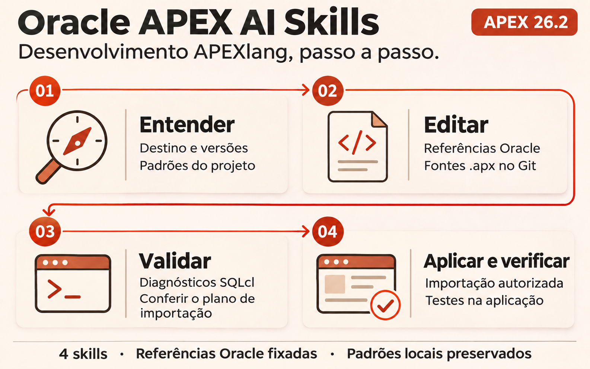

# Oracle APEX AI Skills APEXlang

**Desenvolva Oracle APEX com IA, código versionado e os padrões do seu projeto.**

Quatro skills coordenadas para **Codex e Claude Code** que orientam o agente desde a compreensão da aplicação até a edição do APEXlang, a validação com o Oracle SQLcl e a verificação de uma alteração autorizada na aplicação em execução.

[English](README.md) · [Começar](#comece-em-3-passos) · [Recursos](#o-que-o-kit-ajuda-a-fazer) · [Exemplos](#exemplos-de-pedidos) · [Documentação](#documentação)

[](https://github.com/andre-simplifica/oracle-apex-ai-skills-apexlang/actions/workflows/validate.yml) [Núcleo MIT](LICENSE) · [Referências Oracle: UPL 1.0](THIRD_PARTY_NOTICES.md)



APEXlang representa a aplicação APEX em arquivos de texto editáveis. O kit reúne referências, contexto do projeto e ferramentas para o agente trabalhar nesses arquivos. A instalação é feita como um **kit de skills gerenciado no repositório**; consulte os guias de [Codex](docs/install-codex.md) e [Claude Code](docs/install-claude-code.md).

**Versão atualmente revisada: APEX 26.2.** O trabalho conectado exige SQLcl 26.3+ e ORDS 26.3+. Novas versões do APEX são habilitadas após revisão específica de compatibilidade.

## O que o kit ajuda a fazer

| Sua tarefa | O que o kit oferece |
| --- | --- |
| Adotar uma aplicação após atualização do APEX | Avaliação de prontidão, primeiro baseline APEXlang completo e orientação de recuperação SQL. |
| Criar ou alterar páginas e componentes | Referências Oracle da versão correta, exemplos e instruções para mudanças pontuais nos fontes. |
| Corrigir APEXlang inválido | Diagnósticos do compilador com localização, propriedade e valores permitidos, quando disponíveis. |
| Encontrar um padrão de implementação | Busca ordenada por relevância em português ou inglês, leitura por trechos e cinco exemplos Oracle 26.2 selecionados. |
| Preparar uma importação | Conferência dos fontes e das diferenças com o ambiente, escopo explícito, evidência do compilador e plano com validade de 30 minutos. |
| Manter as convenções da equipe | Atualizações gerenciadas que preservam perfis, padrões, políticas e migrações próprios do projeto. |

O fluxo também cobre PL/SQL, integrações REST, locks de objetos compartilhados em DEV e preparação de releases. A [visão técnica](docs/technical-overview.md) explica o que cada utilitário verifica.

## Comece em 3 passos

### 1. Instale no seu projeto

Peça ao agente:

```text
Instale neste projeto o Oracle APEX AI Skills APEXlang a partir de
https://github.com/andre-simplifica/oracle-apex-ai-skills-apexlang.
Preserve os padrões existentes e o kit anterior. Fixe o commit de origem,
revise o plano de instalação, instale e execute status/doctor.
Não conecte ao Oracle como parte da instalação dos arquivos.
```

O instalador copia quatro skills, utilitários offline e referências Oracle fixadas. [Detalhes da instalação e comandos de terminal](docs/install-codex.md).

### 2. Confira a instalação

Na raiz do projeto que recebeu o kit:

```bash
python3 Util/apexlang/manage_oracle_apexlang_skills.py status --project-root .
python3 Util/apexlang/manage_oracle_apexlang_skills.py doctor --project-root .
```

`HEALTHY` confirma a integridade dos arquivos gerenciados. `FILES_READY` confirma a instalação dos arquivos; a identidade do ambiente e a prontidão da aplicação são verificadas em seguida, separadamente.

### 3. Comece pelo contexto da aplicação

```text
Use $oracle-apex-ai-skills-apexlang para inspecionar os fontes APEXlang
e o contexto da aplicação deste projeto. Resuma as evidências de versão,
os padrões locais e a próxima validação. Informe os dados do destino
que ainda estiverem faltando.
```

Para Claude Code, siga a [configuração de descoberta](docs/install-claude-code.md). Para uma aplicação recém-migrada, comece pelo [roteiro da primeira aplicação](docs/first-application.md).

## Como uma alteração passa pelo kit

1. **Entender.** Confirmar o destino, as versões, o estado dos fontes e os padrões do projeto.
2. **Editar.** Consultar o inventário Oracle fixado e alterar os arquivos `.apx` relevantes.
3. **Validar.** Compilar a aplicação completa offline, analisar os diagnósticos, comparar uma exportação recente e conferir o escopo de importação proposto.
4. **Aplicar e verificar.** Com destino e operação autorizados, importar, testar o comportamento e as permissões e reexportar para conferir o estado entregue.

Os utilitários preparam e verificam planos de importação; eles não executam esses planos. Veja o [fluxo de desenvolvimento](skills/oracle-apexlang-dev/references/daily-workflow.md) para o procedimento completo.

## Exemplos de pedidos

**Adotar uma aplicação existente**

> Avalie a aplicação identificada no perfil deste projeto após sua atualização para APEX 26.2. Exporte e versione o primeiro baseline APEXlang completo com recuperação SQL. Relate a prontidão e as correções propostas separadamente.

**Melhorar um relatório**

> Adicione um filtro de situação ao relatório de pedidos existente nos fontes APEXlang deste projeto. Reutilize as colunas reais e as regras de autorização. Valide a aplicação completa e prepare o plano de importação para revisão.

**Diagnosticar um erro de compilação**

> Valide esta aplicação APEXlang, explique cada erro do compilador usando a definição Oracle correspondente e proponha a menor correção nos fontes.

**Explorar os padrões incluídos**

O catálogo cobre relatório com formulário modal, grids mestre-detalhe, gráficos, calendário e filtro com atualização de região. Cada entrada informa dependências, adaptações e evidência de compilação.

```bash
python3 Util/apexlang/oracle_reference.py search --query 'mestre detalhe' --limit 3
python3 Util/apexlang/oracle_reference.py read --id example:26.2:master-detail-grid
```

Veja a [busca de referências e exemplos](skills/oracle-apexlang-dev/references/oracle-reference-policy.md). A compilação de um exemplo não comprova o comportamento de negócio na sua aplicação.

## Quatro skills, um ponto de entrada

Comece por **`oracle-apex-ai-skills-apexlang`**. Ela direciona o trabalho para o fluxo adequado:

| Skill | Responsabilidade |
| --- | --- |
| [`oracle-apex-ai-skills-apexlang`](skills/oracle-apex-ai-skills-apexlang/SKILL.md) | Instalar, atualizar, conferir versões e escolher o próximo fluxo. |
| [`oracle-apexlang-dev`](skills/oracle-apexlang-dev/SKILL.md) | Desenvolver APEXlang, revisar migrações, diagnosticar e validar alterações. |
| [`oracle-apexlang-export`](skills/oracle-apexlang-export/SKILL.md) | Estabelecer baselines e preparar exports, recuperação e releases. |
| [`oracle-apexlang-object-lock`](skills/oracle-apexlang-object-lock/SKILL.md) | Coordenar alterações em objetos compartilhados do banco em DEV. |

## Compatibilidade

| Componente | Requisito |
| --- | --- |
| APEX | Versão mínima e atualmente revisada: **26.2**. |
| SQLcl | **26.3+**. Builds testadas e evidências do compilador constam na [validação](docs/validation.md). |
| ORDS | **26.3+**; confirmar a versão real do servidor. |
| Banco | 19c RU 19.18+ suportado ou Oracle AI Database 26ai 23.26.0+. |
| Versões futuras do APEX | Exigem revisão de inventário, APIs e fluxo de migração. |

Para APEX 24.2 e seu fluxo baseado em SQL, utilize o kit separado [Oracle APEX AI Skills](https://github.com/andre-simplifica/oracle-apex-ai-skills). Os dois kits usam diretórios distintos e podem coexistir.

## Evidências e limites de alteração

- **A instalação dos arquivos é offline.** Não conecta ao Oracle, importa aplicações ou instala o runtime de locks no banco.
- **Os planos são conferidos com as evidências atuais.** Fontes, configuração de implantação, escopo, versão do SQLcl e prazo precisam continuar válidos. A identidade real do destino e a autorização são conferidas antes da execução.
- **A entrega segue a política do projeto.** Importações seletivas atendem mudanças elegíveis em desenvolvimento/teste. Produção exige artefato completo testado e autorização explícita.
- **As validações têm etapas distintas.** Integridade dos arquivos, compilação, resultado da importação e testes reais são relatados individualmente.

As referências Oracle são preservadas sem alteração, fixadas por commit e verificadas com SHA-256. Consulte as [evidências de validação](docs/validation.md), o fluxo de [implantação e recuperação](skills/oracle-apexlang-export/references/deployment-and-recovery.md) e a [política de segurança](SECURITY.md).

## Documentação

A documentação técnica está em inglês; este README é o guia de entrada em português.

| Quero… | Comece aqui |
| --- | --- |
| Instalar com meu agente | [Codex](docs/install-codex.md) · [Claude Code](docs/install-claude-code.md) |
| Adotar a primeira aplicação | [Primeira aplicação](docs/first-application.md) · [Prontidão e baseline](skills/oracle-apexlang-export/references/readiness-and-first-baseline.md) |
| Desenvolver e diagnosticar | [Fluxo diário](skills/oracle-apexlang-dev/references/daily-workflow.md) · [Busca de referências](skills/oracle-apexlang-dev/references/oracle-reference-policy.md) |
| Preservar padrões locais | [Adaptação ao projeto](docs/adapt-to-your-project.md) |
| Revisar uma migração | [Revisão de configuração](skills/oracle-apexlang-dev/references/application-migration-review.md) |
| Entender versões e APIs | [Revisão da versão 26.2](skills/oracle-apexlang-dev/references/release-notes-26.2.md) · [APIs públicas](skills/oracle-apexlang-dev/references/public-apis-26.2.md) |
| Atualizar ou contribuir | [Atualizações](docs/update-and-contribute.md) · [Contribuição](CONTRIBUTING.md) · [Changelog](CHANGELOG.md) |

## Contribuição e licença

Para validar uma alteração no kit, crie um ambiente virtual, instale `requirements-dev.txt` e execute `bash scripts/validate_repo.sh`. [Detalhes da validação](docs/validation.md).

Núcleo: **MIT**. Referências Oracle: **UPL 1.0**. Veja os [avisos de terceiros](THIRD_PARTY_NOTICES.md) e o [catálogo de fontes](docs/research-sources.json). Este é um projeto independente da comunidade.
